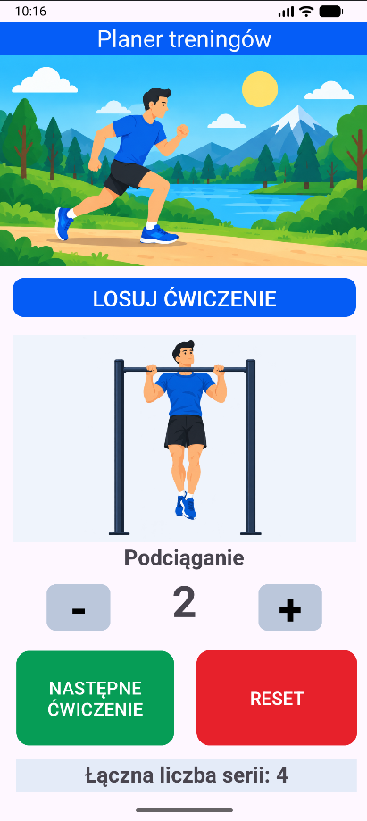

# Planer treningów

## Opis projektu

Planer treningów to aplikacja mobilna na system Android, stworzona w środowisku Android Studio. Umożliwia losowanie ćwiczeń, zapisywanie liczby wykonanych serii oraz kontrolowanie łącznej liczby serii podczas treningu.

Projekt został wykonany w języku Java, a interfejs użytkownika zaprojektowano w XML.

## Podgląd aplikacji

## Funkcje aplikacji

- Losowanie ćwiczeń treningowych.
- Wyświetlanie grafiki i nazwy wylosowanego ćwiczenia.
- Zwiększanie liczby wykonanych serii.
- Zmniejszanie liczby serii, bez możliwości zejścia poniżej zera.
- Przechodzenie do następnego ćwiczenia.
- Zliczanie łącznej liczby wykonanych serii.
- Resetowanie liczników i przywracanie stanu początkowego aplikacji.

## Technologie

- Android Studio
- Java
- XML
- Android SDK
- Git i GitHub

## Zasoby graficzne

Grafiki aplikacji znajdują się w katalogu `app/src/main/res/drawable/`.

- `sportowiec.png` – grafika nagłówkowa.
- `cwiczenie0.png` – grafika początkowa.
- `cwiczenie1.png` – przysiad.
- `cwiczenie2.png` – pompki.
- `cwiczenie3.png` – plank.
- `cwiczenie4.png` – wykroki.
- `cwiczenie5.png` – burpees.
- `cwiczenie6.png` – podciąganie.

## Uruchomienie projektu

1. Sklonuj repozytorium lub pobierz projekt.
2. Otwórz projekt w Android Studio.
3. Poczekaj na zakończenie synchronizacji Gradle.
4. Uruchom aplikację na emulatorze lub urządzeniu z systemem Android.

## Autor
Kacper Boniecki
